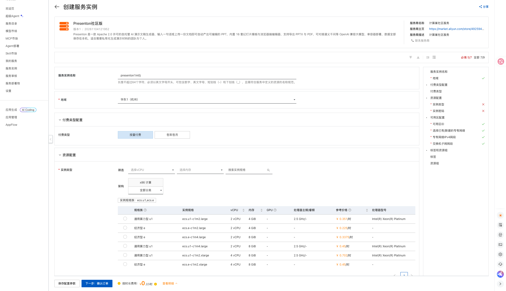

# Presenton Community Edition on Compute Nest

## Overview

Presenton is a self-hosted, Apache 2.0 licensed AI presentation generator. Give it a sentence or upload a document and it produces editable slides, with built-in templates and a browser editor, exporting to PPTX and PDF. This Compute Nest service deploys a single ECS instance with Presenton, Chromium and Docker Compose preinstalled. All data stays on the instance.

The service ships with a built-in account system and is reachable at port 5001 of the instance public IP.

## Billing

The service template itself is free. Deploying an instance incurs charges for:

- ECS instance (minimum 2 vCPU / 4 GiB)
- 200 GiB ESSD system disk (fixed by the template)
- 5 Mbps public bandwidth (fixed by the template)

Both pay-as-you-go and subscription are supported.

## Required RAM permissions

| Policy | Purpose |
| --- | --- |
| AliyunECSFullAccess | Manage ECS resources |
| AliyunVPCFullAccess | Manage VPC resources |
| AliyunROSFullAccess | Manage ROS stacks |
| AliyunComputeNestUserFullAccess | Manage Compute Nest user resources |

## Deployment

1. Open the instance creation page, choose a region, instance type and instance password. Use a new VPC or an existing one.

   [Deploy link](https://computenest.console.aliyun.com/service/instance/create/cn-hangzhou?type=user&ServiceId=service-8c7b9c36bb2f4be1b5c1)

   

2. Review the price and click **Create**.

3. When the instance is deployed, the **Outputs** section shows `presenton_5001_url` and `AdminPassword`.

   

4. Open `http://<public-ip>:5001` and sign in as `admin` with the generated password.

   

## First use

Open the settings page and fill in your own DashScope (Bailian) API key. The template already points to the OpenAI compatible endpoint `https://dashscope.aliyuncs.com/compatible-mode/v1` with model `qwen-plus`, but no key is bundled.

## Parameters

| Parameter | Description | Default |
| --- | --- | --- |
| VpcOption | NewVPC or ExistingVPC | NewVPC |
| VpcCidrBlock | CIDR of the new VPC | 192.168.0.0/16 |
| VSwitchCidrBlock | CIDR of the new vSwitch | 192.168.1.0/24 |
| EcsInstanceType | ECS instance type (2 vCPU / 4 GiB minimum) | none |
| InstancePassword | ECS login password | none |
| PayType | PostPaid or PrePaid | PostPaid |
| ZoneId | Availability zone | none |
| VpcId / VSwitchId | Existing VPC and vSwitch (ExistingVPC only) | empty |

## Outputs

| Output | Description |
| --- | --- |
| presenton_5001_url | Presenton console URL |
| AdminUsername | Administrator user name (admin) |
| AdminPassword | Randomly generated administrator password |

## Security notes

- AI image generation is disabled (`DISABLE_IMAGE_GENERATION=true`); only one model key is needed.
- Mem0 chat memory is disabled (`MEM0_ENABLED=false`).
- The Presenton community gallery and anonymous telemetry are disabled.
- The upstream `DISABLE_AUTH` switch is intentionally not set; every API except login requires an administrator session.
- Data lives in `/opt/presenton/app_data` on the system disk and is deleted with the instance.
