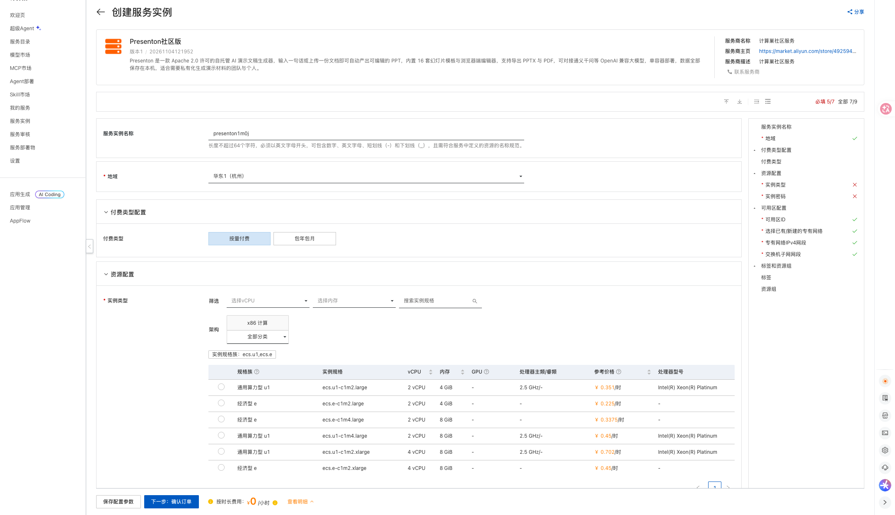
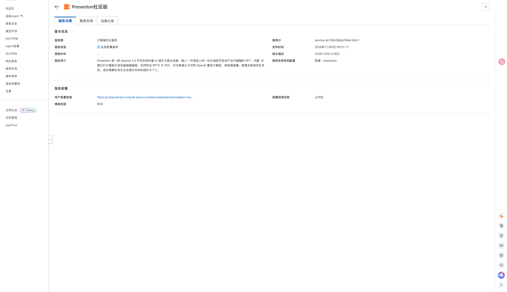
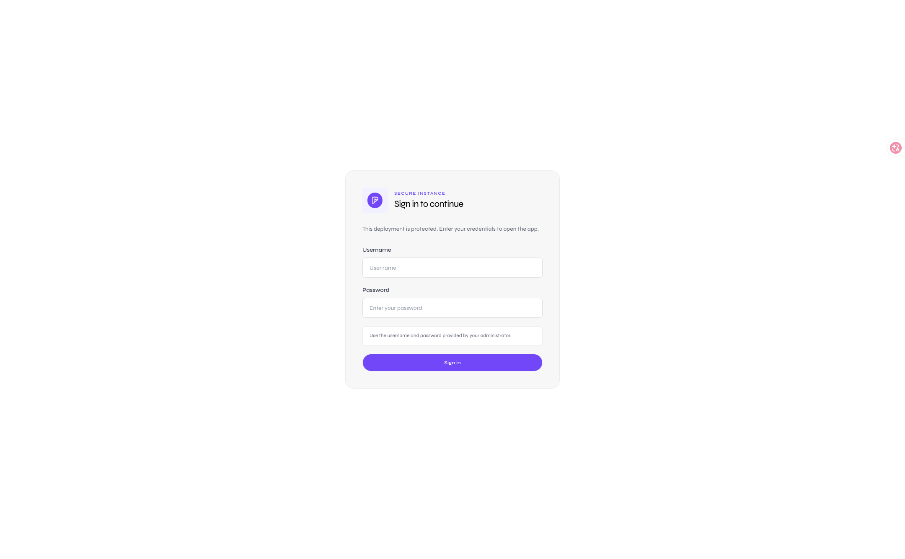

# Presenton社区版计算巢部署文档

## 服务说明

Presenton 是一款 Apache 2.0 许可的自托管 AI 演示文稿生成器：输入一句话或上传一份文档，即可自动生成可编辑的幻灯片，内置多套模板与浏览器端编辑器，支持导出 PPTX 与 PDF。本计算巢服务采用单机 ECS 部署，ECS 镜像内已预置 Presenton、Chromium 与 Docker Compose 运行环境，数据全部保存在实例本机。

该服务带有内置账号体系，访问入口为实例公网 IP 的 5001 端口，登录后可进入 Presenton 控制台。

## 计费说明

通过此服务模板构建服务不产生费用。用户部署服务实例时，资源费用主要涉及：

- ECS 实例规格（最低 2 vCPU、4 GiB 内存）
- 系统盘容量（模板固定 200 GiB ESSD）
- 公网带宽（模板固定 5 Mbps）

计费方式支持按量付费和包年包月，预估费用会在部署前实时展示。

## RAM账号所需权限

若使用 RAM 用户创建服务实例，需要在创建服务实例前为该 RAM 用户添加相应权限。

| 权限策略名称 | 备注 |
| --- | --- |
| AliyunECSFullAccess | 管理云服务器 ECS 的权限 |
| AliyunVPCFullAccess | 管理专有网络 VPC 的权限 |
| AliyunROSFullAccess | 管理资源编排 ROS 的权限 |
| AliyunComputeNestUserFullAccess | 管理计算巢服务用户侧资源的权限 |

## 服务实例部署流程

### 部署步骤

1. 打开计算巢服务实例创建页面，选择部署地域，填写实例规格、实例密码。网络可选择新建 VPC，也可以选择已有机房与交换机。

   [部署链接](https://computenest.console.aliyun.com/service/instance/create/cn-hangzhou?type=user&ServiceId=service-8c7b9c36bb2f4be1b5c1)

   

2. 确认询价明细后点击 **下一步：确认订单**，同意服务协议并点击 **立即创建**。

3. 等待服务实例部署完成。部署完成后，在服务实例详情页的 **输出** 区域查看 `presenton_5001_url` 访问地址和 `AdminPassword` 管理员密码。服务详情页信息如下：

   

4. 用浏览器打开 `http://<实例公网IP>:5001`，使用用户名 `admin` 与输出中的管理员密码登录。

   

## 首次使用配置

### 1. 配置大模型

Presenton 生成演示文稿依赖外部大模型。模板已预置阿里云百炼 OpenAI 兼容端点（`https://dashscope.aliyuncs.com/compatible-mode/v1`）与模型 `qwen-plus`，但未预置任何 API Key。首次使用请进入控制台设置页，在模型配置处填入自己的百炼 API Key 后保存。

### 2. 数据持久化

Presenton 生成的演示文稿、账号与会话配置保存在实例系统盘的 `/opt/presenton/app_data` 目录，容器重启或重建不会丢失数据；释放服务实例时该目录会随实例一起删除。

## 参数说明

| 参数 | 说明 | 默认值 |
| --- | --- | --- |
| VpcOption | 网络类型，新建 VPC 或使用已有 VPC | NewVPC |
| VpcCidrBlock | 新建 VPC 的网段 | 192.168.0.0/16 |
| VSwitchCidrBlock | 新建交换机的网段 | 192.168.1.0/24 |
| EcsInstanceType | ECS 实例规格，最低 2 vCPU 4 GiB | 无 |
| InstancePassword | 实例登录密码 | 无 |
| PayType | 付费类型 | PostPaid |
| ZoneId | 可用区 | 无 |
| VpcId / VSwitchId | 已有 VPC 与交换机 ID（选择已有 VPC 时填写） | 空 |

## 输出说明

| 输出 | 说明 |
| --- | --- |
| presenton_5001_url | Presenton 控制台访问地址 |
| AdminUsername | 管理员用户名（admin） |
| AdminPassword | 系统随机生成的管理员密码 |

## 安全与使用说明

- 出厂关闭 AI 配图与图库配图（`DISABLE_IMAGE_GENERATION=true`），部署只需要配置一个大模型 Key；如需配图，可在控制台设置页自行配置图片源。
- 出厂关闭 Mem0 对话记忆（`MEM0_ENABLED=false`），该功能依赖宿主机上的 Ollama 服务，云上实例默认不启用。
- 出厂关闭 Presenton 官方社区画廊与匿名使用统计，实例不会向境外服务发送数据。
- 模板刻意不设置上游的 `DISABLE_AUTH` 免鉴权开关，除登录接口外所有 API 都需要管理员会话。
- 所有数据保存在系统盘 `/opt/presenton/app_data`，释放服务实例会一并删除，请提前备份需要的演示文稿。

## 常见问题

**登录后无法生成演示文稿？**
检查设置页中的大模型 API Key 是否已填写、端点与模型名是否正确。

**导出 PPTX 或 PDF 失败？**
导出依赖镜像内置的 Chromium，大文件导出会短暂占用较多内存，建议使用 4 GiB 以上内存规格。
